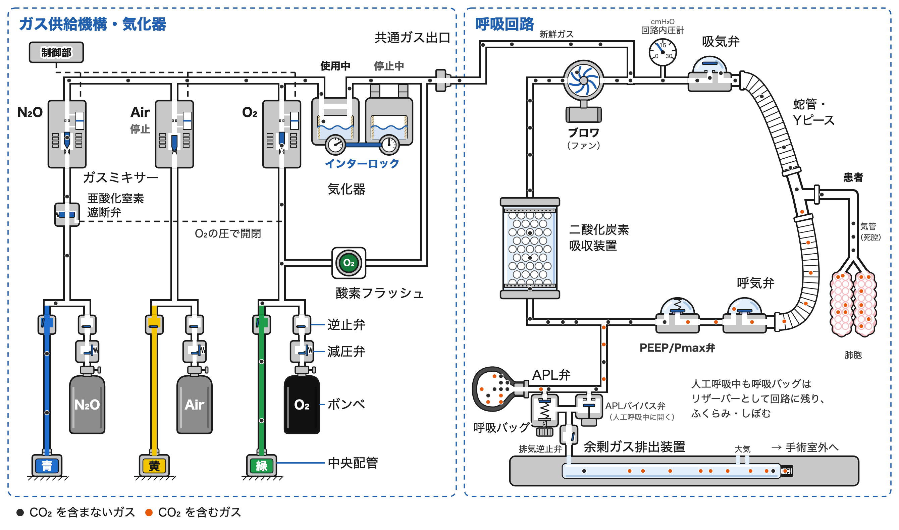
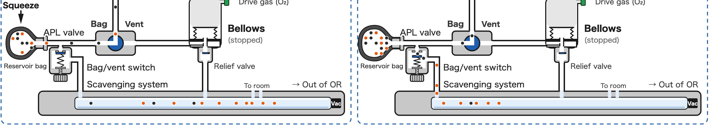
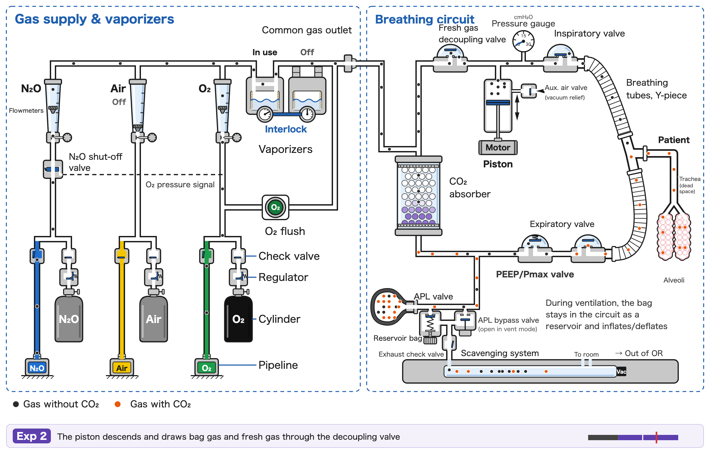
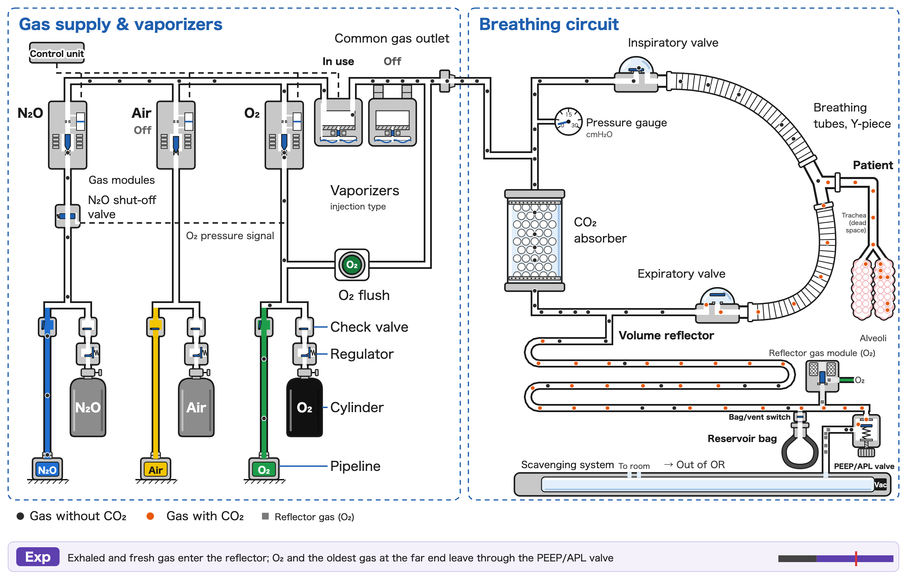
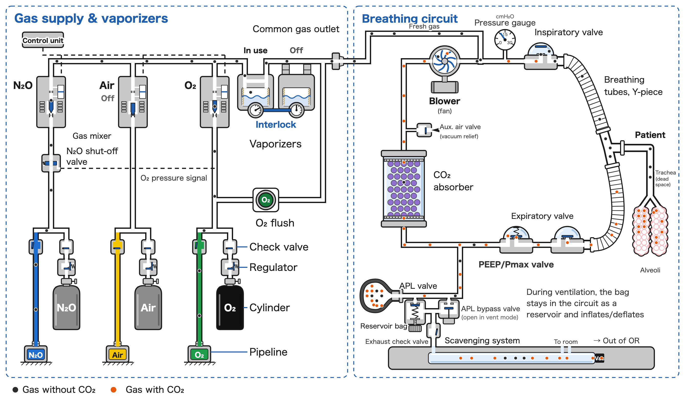
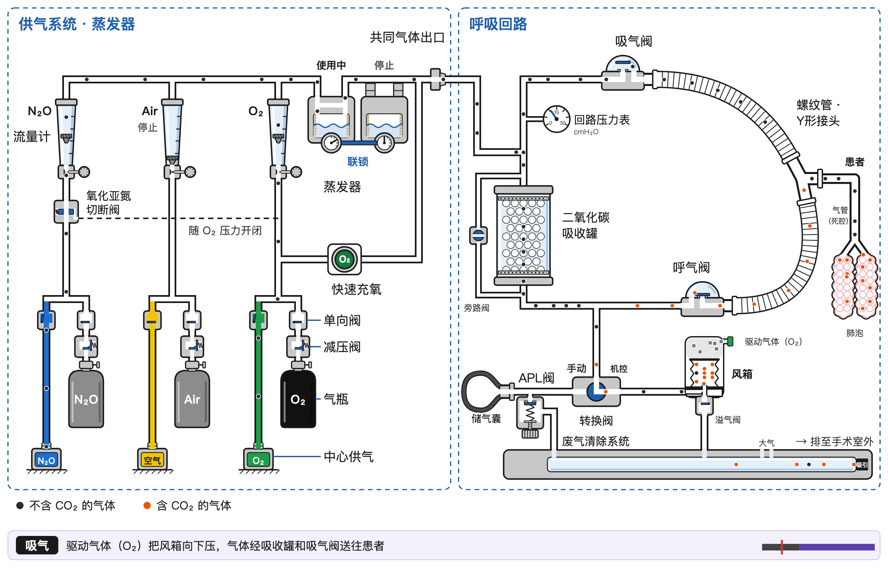
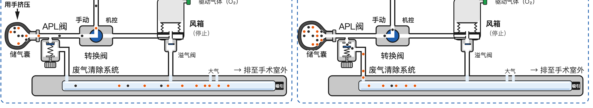
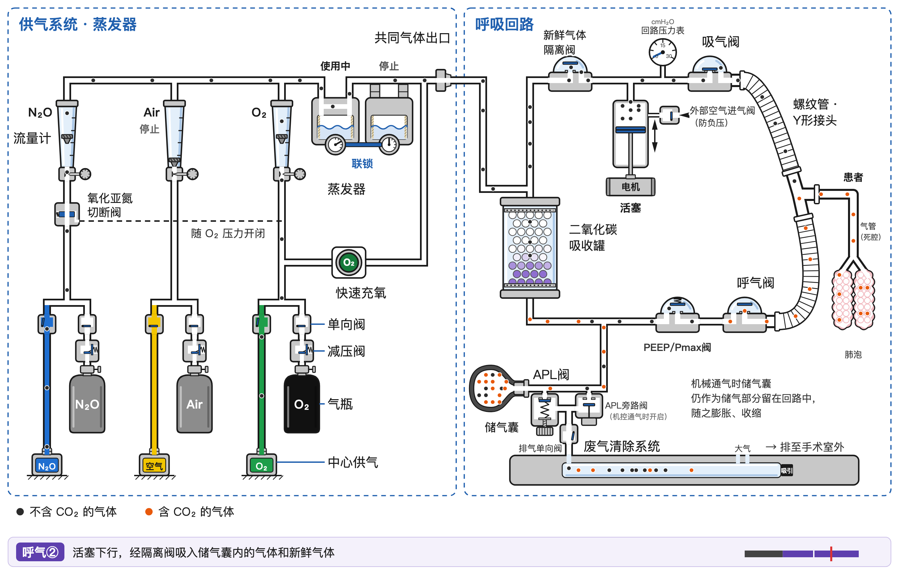
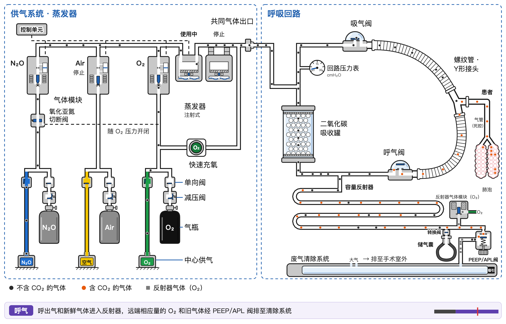
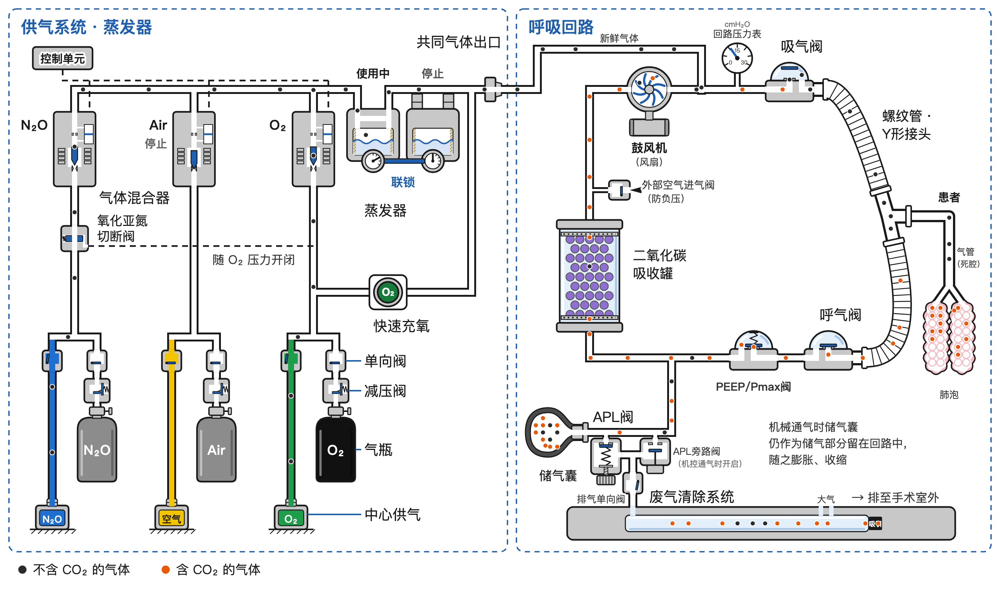

<a id="japanese"></a>

# CircleFlow：麻酔器と呼吸回路のガスの流れ

**日本語** ｜ [English](#english) ｜ [简体中文](#chinese)

麻酔器の中を流れるガスを、1 粒ずつ動く粒で見せる教育用のシミュレーターです。ガス供給機構・気化器から、循環式の呼吸回路（circle system）、人工呼吸器、患者の死腔・肺胞、二酸化炭素吸収装置、余剰ガス排出装置まで、1 呼吸（6 秒）のあいだのガスの動きを 1 つのページで追えます。臨床工学技士・医学生・研修医などの学習用に作りました。

**ページを開く**：https://anesthesia-sims.github.io/circleflow/ ／ English: https://anesthesia-sims.github.io/circleflow/en/ ／ 简体中文: https://anesthesia-sims.github.io/circleflow/zh/


## できること

- **4 つの方式を比べる**：麻酔器の人工呼吸器は、ガスをためる場所と押す力で、ベローズ式（双回路。上昇式と下降式）・ピストン式（単回路）・ブロワ（タービン）式（単回路）・ボリュームリフレクタ式に分けられます。このページでは、ベローズ式（上昇式。駆動ガスがベローズを押し下げる）、ピストン式（モーターがピストンを動かす。新鮮ガス・デカップリング弁つき）、ブロワ（タービン）式（モーターが回すラジアルファンが回路の中で流れと圧を作る。デカップリング弁はなく、ガス供給は電子制御のガスミキサー）、ボリュームリフレクタ式（リフレクタガス（O₂）が、長い管にためたガスを膜なしで押し出す。ガス供給は電子制御のガスモジュールと注入式の気化器）を、タブで切り替えて比べられます。
- **CO₂ を含むガスを色で見る**：黒い粒は CO₂ を含まないガス、オレンジの粒は CO₂ を含むガス（呼気）です。肺胞で CO₂ を受け取り、二酸化炭素吸収装置を通ると CO₂ が除かれます。灰の粒はボリュームリフレクタ式のリフレクタガス（O₂）で、患者側のガスと膜なしで接しています。
- **粒を追跡する**：粒をクリックすると、その粒の通った道を赤い足跡で表示します。
- **吸収剤の消費を見る**：CO₂ を吸収した吸収剤は、指示薬の色が白から紫へ変わっていきます（時間を縮めて表示。4 倍・16 倍で早送りできます）。使い切ると CO₂ が吸気側へ戻ります（新鮮ガスが多めの場面では、ほとんど戻りません）。「交換」で新しい吸収剤に戻せます。ベローズ式の図には、一部の機種にある吸収装置のバイパス（換気を止めずに吸収剤を交換するための迂回路）を閉じた状態で描いてあります。
- **場面を切り替える**：新鮮ガス（多め／低流量）と換気（人工呼吸／用手換気）を切り替えられます。ボリュームリフレクタ式の人工呼吸では、新鮮ガスが患者の取り込みより少ない「不足」も選べ、リフレクタガス（O₂）が回路へ入っていくのが見えます。方式と合わせて 17 の場面があります。用手換気では、呼吸バッグを手で押して換気し、余ったガスは APL 弁（ボリュームリフレクタ式では PEEP/APL 弁）から排出されます。




## 使い方

`index.html` をブラウザで開くだけで動きます（インターネット接続も、ほかのファイルも要りません）。英語版は `en/index.html`、中国語（簡体字）版は `zh/index.html` で、見出しの横のリンクで行き来できます。日本語版は、ブラウザの言語が日本語でないときに英語版（中国語のブラウザでは中国語版）を 1 行で案内します（自動では移りません）。

公開ページは、閲覧数を Cloudflare Web Analytics で数えています（cookie を使わず、個人を特定する情報は集めません）。ファイルとして開いたとき、画像撮り用のコマ（`?t=`）では数えません。

初めて学ぶ人向けに、画面には図と操作だけを置き、説明は必要なときに重ねて出します。

- **使い方**：「使い方」ボタン（または <kbd>?</kbd> キー）で、画面の上を指が動いて操作を順に見せます。初めて開いたときは自動で出ます
- **見どころ**：ふだんは気づかないが知ると回路の理解が深まる細部を 9 つ、方式を切り替えて見比べながら案内します（余剰ガス弁がつくる PEEP、死腔、呼気中の新鮮ガスの行き先、吸気中の新鮮ガスと 1 回換気量、吸収剤、APL 弁が開く順序、気化器の違い、不足で O₂ が患者に届く、ブロワの回転と循環流）。
- **部品の名前をクリック**：点線の下線がある名前をクリックすると、その部品を拡大して、はたらきを短く説明します。「前へ・次へ」でガスの流れの順に部品をたどれます
- **時刻のバー**：吸気・呼気のバーを押すとその時刻で止まり、いま起きていることを説明します
- **くわしく**：人工呼吸器の分類と 4 つの方式の比較や、吸収剤の消費のくわしい説明
- **ほかのページへの埋め込み**：`<iframe src="https://anesthesia-sims.github.io/circleflow/" allowfullscreen>` で入れられます。iframe の中では、中身の高さを親のページへ `postMessage(['setHeight', 高さ(px)], '*')` で知らせるので、親のページで受けて iframe の高さを合わせれば縦のスクロールバーが出ません（東大麻酔科のサイトの AnesSimulator と同じ約束。受け方は「くわしく」の下の例）
- **スマートフォン**：縦向きでは図の右半分（呼吸回路）から始まり、「全体・ガス供給・呼吸回路」で表示範囲を切り替えられます。図は 2 本指で拡大、指でずらせます。横向きにすると図が大きく見え、「全画面」でブラウザの枠を消せます（勉強会のスクリーン投影にも）
- スペースキー：再生／一時停止
- ← →：0.1 秒ずつ送る
- Esc：説明を閉じる／粒の追跡をやめる
- `index.html?term=inspValve` のように開くと、その部品の説明を開いた状態になります（教科書やスライドから部品へ直接つなぐ用。名前は `src/page_terms.py` の `TERMS`）
- `index.html?type=pistonMan&t=1.5` のように開くと、その場面・時刻で止めた 1 コマになります（動画や図のコマ撮り用）。場面の名前は `bellows`・`bellowsLow`・`bellowsMan`・`bellowsLowMan`・`piston`・`pistonLow`・`pistonMan`・`pistonLowMan`・`reflector`・`reflectorLow`・`reflectorShort`・`reflectorMan`・`reflectorLowMan`・`blower`・`blowerLow`・`blowerMan`・`blowerLowMan` です。

親のページで受ける例（WordPress の「カスタム HTML」ブロックにそのまま貼れます）：

```html
<iframe id="circleflowFrame" src="https://anesthesia-sims.github.io/circleflow/" title="CircleFlow" style="width:100%;border:0;height:800px" allowfullscreen></iframe>
<script>window.addEventListener('message', function (e) {
  if (e.origin !== 'https://anesthesia-sims.github.io' || !Array.isArray(e.data) || e.data[0] !== 'setHeight') return;
  document.getElementById('circleflowFrame').style.height = Math.max(400, e.data[1]) + 'px';
});</script>
```

## 作り直し方

図（SVG）と粒の経路データは Python のスクリプトが作り、粒の動きはブラウザの中で JavaScript が計算します。`src/` を直したら、次の 2 つで作り直して点検します。

```sh
./build.sh    # build/ に 17 の場面の図と経路データを日本語・英語・中国語で作り、index.html・en/index.html・zh/index.html にまとめる（Python 3、標準ライブラリだけ）
./check.sh    # 17 の場面の粒の動きを点検する（Node.js）
```

版を上げるときは `VERSION` を直して作り直し、git のタグ（`v1.2.10` の形）を打ちます。2 桁目が上がるときは「更新記録」に 1 行足します。閲覧数を数えるための Cloudflare Web Analytics のトークンは `build.sh` に書いてあります（`CIRCLEFLOW_CF_TOKEN= ./build.sh` で計測なしに作れます。複製して公開するときは自分のトークンに替えるか空にしてください）。

`check.sh` は場面ごとに、粒が管の外にはみ出していないこと、巻き戻しても同じ状態になること、1 回換気量（1 呼吸で肺胞へ入る粒の数）、吸収剤を使い切るまでの呼吸の数を表示します。

| ファイル | 役割 |
|---|---|
| `src/figure_bellows.py`・`src/figure_piston.py`・`src/figure_reflector.py`・`src/figure_blower.py` | ベローズ式（上昇式）／ピストン式／ボリュームリフレクタ式／ブロワ（タービン）式の図（SVG）と粒の経路データを作る（`low`：低流量、`short`：不足（リフレクタ式のみ）、`manual`：用手換気、`en`：英語、`zh`：中国語） |
| `src/palette.py`・`src/svg.py`・`src/parts.py`・`src/geometry.py` | 3 つの図で共通の、色、SVG の道具、部品（弁・バッグ・肺胞など）の描き方、折れ線の計算 |
| `src/labels_en.py`・`src/labels_zh.py` | 図の中の文字の英語版・中国語（簡体字）版（日本語との対応表と、文字の大きさ・位置の調整） |
| `src/sim_common.js`・`src/sim_bellows.js`・`src/sim_piston.js`・`src/sim_reflector.js`・`src/sim_blower.js` | 粒の動きのシミュレーション（ブラウザで動く）。共通部分と方式ごとの部分 |
| `src/build_page.py` | 17 の場面を 1 つのページにまとめる（`--lang en` で英語版、`--lang zh` で中国語版） |
| `src/page_css.py`・`src/page_html.py`・`src/page_js.py`・`src/page_terms.py` | ページの見た目、HTML、操作の JavaScript、部品の解説と画面の文（日本語） |
| `src/page_en.py`・`src/page_zh.py` | ページの英語版・中国語（簡体字）版の文（画面・部品の解説・場面の説明・使い方） |
| `tests/check.js` | 1 つの場面の粒の動きの点検（`check.sh` が 17 の場面に対して回す） |
| `tools/text_list.py` | ページに出る解説文をすべて Markdown に書き出す |

## 模式図としての注意

- 教育用の模式図です。臨床の判断や、実際の麻酔器の操作・点検に用いるものではありません。内容について保証はありません。
- 部品の形・位置・弁の構成は機種によって異なります。ピストン式は Dräger Fabius 型、ボリュームリフレクタ式は Getinge（Maquet）Flow-i 型の構成を参考にしていますが、特定のメーカーや機種とは関係ありません。
- ガスの量（粒の数）や時間、吸収剤の容量は、見やすさのために縮めたり整えたりした値です。実際の機種どうしの性能の比較ではありません。
- 配管とボンベの識別色は日本の規格に従っています（配管：O₂ 緑・空気 黄・N₂O 青、ボンベ：O₂ 黒・そのほか灰）。識別色は国によって違います。ISO の規格（欧州など。中国の配管も同じ）では、配管は O₂ 白・空気 黒と白・N₂O 青、医療用のボンベは胴が白で肩にガスの色（O₂ 白・N₂O 青・空気 黒と白）です。米国では、配管は O₂ 緑・空気 黄・N₂O 青、ボンベは O₂ 緑・N₂O 青です。

## 更新記録

| 版 | 日付 | 内容 |
|---|---|---|
| 1.8 | 2026-11-08 | 中国語（簡体字）版を追加（`zh/index.html`）。図の文字・画面・部品の解説・場面の説明・ツアーを中国語にした。図の識別色は日本の色のままで、中央配管とボンベの解説に中国の色（配管は GB 50751、ボンベは GB/T 7144）を書いた。日本語版は、ブラウザの言語が中国語なら中国語版を案内する。1.8.1（11-08）：公開ページの閲覧数を Cloudflare Web Analytics で数える（cookie なし。ページの下に表示）。1.8.2（11-08）：検索結果の説明と、SNS でリンクを共有したときのプレビュー（画像は日英中ごと）を付けた。サイトマップと引用情報（`CITATION.cff`）を追加 |
| 1.7 | 2026-11-05 | 平林剛先生の提案で 2 つ追加。①吸収装置のバイパス（ベローズ式の図。一部の機種にある迂回路を栓つきで描き、「バイパス」ボタンで開閉。開くと粒は吸収剤を通らず CO₂ が患者へ戻り、作動中は赤い札で知らせる。巻き戻しても同じ時刻に開閉）。1.7.1：著者の判断でボタンと見どころの段をなくし、図に閉じた姿で描いて解説するだけに（25 段）。1.7.2：ブロワ式の図に外気取り込み弁（陰圧防止）を描き足し、「回路のガスが足りないとき」をピストン式・ブロワ式とも弁が開く形に。換気中に吸収剤を交換できる仕組みが 4 方式すべての機種にあること（GE・Mindray・Flow-i のバイパス、Dräger の CLIC アダプター）を追記。1.7.3：見どころを 32 段に組み直し、冒頭に「ガスを送り出すしくみ」（4 方式）、吸収剤の節に「換気を止めずに吸収剤を交換する」、最後に「回路のガスが足りないとき」（4 方式。ピストン式・ブロワ式の外気取り込み弁を含む）を加え、気化器の段のブロワ式の重複を整理。1.7.4：見どころの「換気を止めずに吸収剤を交換する」の段で、バイパス弁を 2 呼吸目に開いて 4 呼吸目に閉じる（低流量・等速。栓が回り、粒が迂回路を通って CO₂ が吸気側へ。シミュレーションの時刻で予約し、段を離れると記録ごと消す）。②「くわしく」に「回路のガスが足りないとき」の節（ベローズが上がらない・呼気相でフラッシュ、ピストン式とブロワ式はバッグがぺちゃんこ、リフレクタ式は気づきにくい）と吸収剤の節にバイパスの段落。ベローズと呼吸バッグの解説にも注意点を追記。1.7.5（11-07）：ほかのページの iframe に入れたとき、中身の高さを親へ `postMessage(['setHeight', px])` で知らせ、画面の高さから幅を決めるのをやめた（東大麻酔科のサイトへの埋め込み用）。1.7.6（11-07）：ブロワ式の吸気弁は、人工呼吸の呼気中も循環流で少し開き、粒が弁板の下をくぐって通る（吸気中はそれより大きく開く）。1.7.7（11-08）：英語版の中央配管とボンベの解説に、ガスの識別色は国によって違うこと（ISO と米国の例）を加えた |
| 1.6 | 2026-11-05 | 4 つ目の方式「ブロワ（タービン）式」（Dräger Perseus 型）を追加（新鮮ガス 多め／低流量 × 人工呼吸／用手換気の 4 場面、全 17 場面）。ピストン・シリンダーの代わりにモーターで回るラジアルファンを吸気側の管に置き、新鮮ガス・デカップリング弁はなく、新鮮ガスはブロワの出口と吸気弁のあいだで加わる。呼吸バッグは人工呼吸中もリザーバー。ガス供給は電子制御のガスミキサー（ガスごとのモジュール）と可変バイパス式の気化器。ブロワとガスミキサーの解説、比較表の 5 列目、見どころのツアーに 4 段（22 段に）。Miller's Anesthesia 10e 第 20 章・Dräger 特許 US9399104B2・Perseus A500 の資料にもとづく。1.6.1：人工呼吸の呼気中にブロワがゆっくり回って保つ小さな循環流（約 0.6 L/分）を入れた。新鮮ガスはブロワを逆流せず、循環流に乗って吸気弁から Y ピースを回り、呼気側から呼吸バッグへ入る（吸気弁は呼気中も少し開く）。呼気がバッグに先に届くので、多めでも吸収剤が 20 数呼吸で使い切られる。1.6.2：見どころにブロワ式の段を 3 つ追加（吸収剤の減り方、気化器の違い、ブロワは吸気で速く・呼気でゆっくり回る。25 段） |
| 1.5 | 2026-11-05 | スマートフォン対応。図を 2 本指で拡大、指でずらせるようにし、縦向きの狭い画面では「全体・ガス供給・呼吸回路」の表示範囲を切り替えられる（呼吸回路から始まる）。横向きの案内と「全画面」ボタンを追加し、横向きでは操作部を 1 段にまとめた。狭い画面では見どころのツアーが示す範囲へ寄る。1.5.1：狭い画面の見どころで、いまの範囲から次の範囲へ連続して寄り、穴と吹き出しが一緒に動くようにした（全体へ戻ってから寄り直さない。範囲の縦横比は示す細部に合わせる）。1.5.2：「全画面」ボタンは全画面にする関数があれば出し（iPhone の Safari で出ていなかった）、押しても全画面にならないブラウザでは隠す。1.5.3：2 本指で広げたあとの 1 本指のずらしが、iPhone の Safari でページのスクロールになっていたのを直した。1.5.4：上昇式ベローズの駆動ガス（O₂）の管の先端に、O₂ の識別色の帯を付けた。1.5.5：方式の名前を「ベローズ式（上昇式）」に改め、「くわしく」に人工呼吸器の分類（ベローズ式・ピストン式・ブロワ（タービン）式・ボリュームリフレクタ式、双回路と単回路）を加えた |
| 1.4 | 2026-11-05 | 「見どころ」のツアーを追加。ふだんは気づかない細部を 9 つ、方式と場面を自動で切り替えて案内する。1.4.1：開いたときに新しい版があれば 1 回だけ自動で読み直す。1.4.2：見どころを方式ごとに切り替えて見比べる 18 段に（気化器の違いを追加）。1.4.3：ツアーをキーで操作（Esc で閉じる、← BS で戻る、→ Enter スペースで進む）。1.4.5：使い方のツアーに見どころの紹介を追加 |
| 1.3 | 2026-11-04 | ボリュームリフレクタ式のガス供給を実機（Flow-i）の構成に合わせ、流量計と可変バイパス式の気化器の代わりに、電子制御のガスモジュール・注入式の気化器・制御部を描いた。人工呼吸の新鮮ガスは主に吸気中に流れる形に（1 呼吸の 2/3 を吸気中）。新鮮ガスが患者の取り込みより少なく、リフレクタガス（O₂）が回路へ入っていく「不足」の場面を追加（全 13 場面）。説明文の断定（上昇式ベローズの陰圧、APL 弁が開く条件、リフレクタの両端のガス）を直し、気化器では O₂・N₂O の両方が気化室とバイパスを通るようにした。1.3.1：配管からガスモジュールへの管の途切れと、供給路の粒の間隔の乱れを直し、全場面の 1 回換気量を 13 粒にそろえた。1.3.2：リフレクタ式の人工呼吸で、ガスモジュールより上流の粒を一定に流し、吸気中に多く通す流量の変化はモジュールの弁で作る形にした。1.3.4〜1.3.11：リフレクタガスがガスモジュールから流れ込むようにし、モジュールの内部を弁座のある L 字に、電磁コイルを鉄心の両側の巻線の断面（通電中は黒）に描き直した。押すためのガス（リフレクタガスと上昇式ベローズの駆動ガス）を灰の四角で示し、リフレクタガスのいる範囲の管腔を薄い灰で塗る（ポインターを重ねると名前が出る）。描かれていなかった部品の縁を直した。「不足」の場面は数呼吸で O₂ が肺胞に届く状態から始め、肺胞の中でも O₂ の粒を四角のまま見せる |
| 1.2 | 2026-11-03〜04 | ボリュームリフレクタ式に用手換気の場面を追加（全 12 場面）。3 つの方式の図の幅と配置をそろえ、スマートフォンでは操作部を切り替えボタンにまとめた。余剰ガスの経路、呼吸バッグから出る粒の速さ、笑気の供給の表示などを修正。ボリュームリフレクタ式の新鮮ガスは、一定に流れ、呼気中は吸収装置を逆向きに通ってリフレクタへ入る形に改めた |
| 1.1 | 2026-11-03 | ボリュームリフレクタ式（Getinge Flow-i 型）を追加（人工呼吸の 2 場面）。解説の文を読者向けに整理 |
| 1.0 | 2026-11-02 | 公開。上昇式ベローズとピストン式の 8 場面、日本語版と英語版、部品の解説と使い方のツアー |

表は 2 桁目の版ごとにまとめています。細かな修正（3 桁目）は git のタグと履歴に残します。いまの版は `VERSION` の値で、ページの下にも出ます。

## ライセンス

- **プログラム**（`src/`・`tests/`・`build.sh`・`check.sh`、`index.html` の中の HTML・CSS・JavaScript）：[MIT ライセンス](LICENSE)
- **図と文章**（スクリプトが描く図そのもの、`docs/` の画像、ページと README の説明文）：[クリエイティブ・コモンズ 表示 4.0 国際（CC BY 4.0）](LICENSE-CONTENT)

図や文章を使うときは、次のように出典を示してください。

> 朝元雅明（Masaaki Asamoto）「CircleFlow：麻酔器と呼吸回路のガスの流れ」CC BY 4.0

論文や教材で引用するときは、`CITATION.cff` の書式も使えます（GitHub のリポジトリの画面の「Cite this repository」）。

## 著作者

朝元雅明（Masaaki Asamoto）、麻酔科医

## 謝辞

帝京大学医学部附属溝口病院 麻酔科の平林剛先生から、呼吸回路と人工呼吸器の方式について助言をいただきました。内容の誤りは著者の責任です。

もし間違いに気づかれましたら、[GitHub の Issue](https://github.com/anesthesia-sims/circleflow/issues/new) へ投稿していただくか、メール（[masaaki.asamoto@gmail.com](mailto:masaaki.asamoto@gmail.com?subject=CircleFlow)）でご連絡をお願いします。

---

<a id="english"></a>

# CircleFlow: Gas Flow in the Anesthesia Machine and Breathing Circuit

[日本語](#japanese) ｜ **English** ｜ [简体中文](#chinese)

An educational simulator that shows the gas inside an anesthesia machine as individual moving particles. From the gas supply and vaporizers, through the circle breathing system, the ventilator, the patient's dead space and alveoli, the CO₂ absorber and the scavenging system, you can follow how gas moves during one breath (6 s) on a single page. It was made for clinical engineers, medical students and residents.

**Open the simulator**: https://anesthesia-sims.github.io/circleflow/en/ (English) ／ https://anesthesia-sims.github.io/circleflow/ (Japanese) ／ https://anesthesia-sims.github.io/circleflow/zh/ (Simplified Chinese)


## What you can do

- **Compare four ventilator types**: anesthesia ventilators are classified by where the gas is stored and what pushes it: bellows (double circuit; ascending or descending), piston (single circuit), blower/turbine (single circuit) and volume reflector. This page covers all four: the bellows (ascending; drive gas pushes the bellows down), the piston type (a motor drives the piston; with a fresh gas decoupling valve), the blower (turbine) type (a motor-driven radial fan inside the circuit creates the flow and pressure; no decoupling valve, and the gas supply is an electronically controlled gas mixer), and the volume reflector type (reflector gas, O₂, pushes the gas stored in a long tube with no membrane between them; the gas supply is electronically controlled gas modules with an injection vaporizer). Switch between them with the tabs.
- **See CO₂ by color**: black particles are gas without CO₂, orange particles are gas with CO₂ (exhaled gas). Particles pick up CO₂ in the alveoli and lose it in the CO₂ absorber. Gray particles are the reflector gas (O₂) of the volume reflector type, in direct contact with the patient-side gas.
- **Follow a particle**: click a particle to show its path as a red trail.
- **Watch the absorbent being used up**: as the absorbent takes up CO₂, its indicator changes from white to purple (time is compressed; speed up to 4× or 16×). Once it is exhausted, CO₂ returns to the inspiratory side (hardly at all in the scenes with high fresh gas flow). Press Replace for fresh absorbent. The bellows figure also shows, closed, the absorber bypass found on some machines (a channel around the absorber for changing the absorbent without stopping ventilation).
- **Switch scenes**: fresh gas (High / Low flow) and ventilation (Ventilator / Manual). With the volume reflector on the ventilator you can also choose Too low, where fresh gas is less than the patient's uptake and reflector gas (O₂) is seen entering the circuit. Together with the four types, there are 17 scenes. In manual ventilation you squeeze the reservoir bag, and excess gas leaves through the APL valve (the PEEP/APL valve on the volume reflector type).









## How to use

Just open `en/index.html` (English), `index.html` (Japanese) or `zh/index.html` (Simplified Chinese) in a browser; no internet connection or other files are needed. A link next to the title switches languages. When the Japanese page is opened in a browser whose language is not Japanese, it shows a one-line notice pointing to the English version, or to the Chinese version in a Chinese-language browser (it does not redirect).

The published pages count page views with Cloudflare Web Analytics (no cookies, no personally identifying data). Opening the file locally or a still frame (`?t=`) is not counted.

For beginners, the screen shows only the figure and the controls; explanations appear on top only when you ask for them.

- **How to use**: the How to use button (or the <kbd>?</kbd> key) starts a tour in which a finger moves over the screen and shows each control. It starts automatically the first time.
- **Highlights**: a guided tour of nine easy-to-miss details, comparing the four types step by step (the PEEP made by the relief valve, dead space, where fresh gas goes during expiration, fresh gas and tidal volume, the absorbent, when the APL valve opens, how the vaporizers differ, O₂ reaching the patient when fresh gas is too low, the blower's speed and circle flow).
- **Click a part name**: names with a dotted underline zoom in on that part and explain what it does. Prev / Next follow the parts in the order the gas flows.
- **Time bar**: press the inspiration / expiration bar to stop at that moment and see what is happening.
- **Learn more**: the classification of anesthesia ventilators, how the four types differ, and details of absorbent use.
- **Embedding in another page**: use `<iframe src="https://anesthesia-sims.github.io/circleflow/en/" allowfullscreen>`. Inside an iframe the page reports its content height to the parent with `postMessage(['setHeight', heightInPx], '*')`; set the iframe height from that message and no inner scroll bar appears (the same convention as AnesSimulator on the University of Tokyo anesthesiology site; see the example below).
- **On a phone**: in portrait the page starts with the right half of the figure (the breathing circuit); All / Gas supply / Circuit switch the view. Pinch to zoom and drag to move the figure. Turn the phone sideways for a larger figure, and use Full screen to hide the browser bars (also handy for projecting in class).
- Space: play / pause; ← →: step 0.1 s; Esc: close an explanation or stop following a particle.
- Open `en/index.html?term=inspValve` to start with that part's explanation open (for linking from textbooks or slides; the names are the keys of `TERMS` in `src/page_terms.py`).
- Open `en/index.html?type=pistonMan&t=1.5` to get a still frame of that scene at that time (for video or figure capture). Scene names: `bellows`, `bellowsLow`, `bellowsMan`, `bellowsLowMan`, `piston`, `pistonLow`, `pistonMan`, `pistonLowMan`, `reflector`, `reflectorLow`, `reflectorShort`, `reflectorMan`, `reflectorLowMan`, `blower`, `blowerLow`, `blowerMan`, `blowerLowMan`.

Example for the parent page (paste as is into a WordPress Custom HTML block):

```html
<iframe id="circleflowFrame" src="https://anesthesia-sims.github.io/circleflow/en/" title="CircleFlow" style="width:100%;border:0;height:800px" allowfullscreen></iframe>
<script>window.addEventListener('message', function (e) {
  if (e.origin !== 'https://anesthesia-sims.github.io' || !Array.isArray(e.data) || e.data[0] !== 'setHeight') return;
  document.getElementById('circleflowFrame').style.height = Math.max(400, e.data[1]) + 'px';
});</script>
```

## Building

Python scripts draw the figures (SVG) and the particle paths; JavaScript computes the particle motion in the browser. After editing `src/`, rebuild and check with:

```sh
./build.sh    # builds the 17 scenes in Japanese, English and Chinese and writes index.html, en/index.html and zh/index.html (Python 3, standard library only)
./check.sh    # checks the particle motion in all 17 scenes (Node.js)
```

To release a new version, update `VERSION`, rebuild, and tag the commit (`v1.2.10`). Add a line to the Changelog when the minor version changes. The Cloudflare Web Analytics token for counting page views is set in `build.sh` (run `CIRCLEFLOW_CF_TOKEN= ./build.sh` to build without it; if you publish a copy, use your own token or leave it empty).

For each scene, `check.sh` reports that no particle leaves its tube, that rewinding reproduces the same state, the tidal volume (particles entering the alveoli per breath), and the breath at which the absorbent is used up.

| File | Purpose |
|---|---|
| `src/figure_bellows.py`, `src/figure_piston.py`, `src/figure_reflector.py`, `src/figure_blower.py` | Draw the figure (SVG) and particle paths for each ventilator type, bellows (ascending) / piston / volume reflector / blower (`low`: low flow, `short`: too low (reflector only), `manual`: manual ventilation, `en`: English labels, `zh`: Chinese labels) |
| `src/palette.py`, `src/svg.py`, `src/parts.py`, `src/geometry.py` | Shared by the three figures: colors, SVG helpers, part drawings (valves, bag, alveoli, …), polyline math |
| `src/labels_en.py`, `src/labels_zh.py` | English and Simplified Chinese labels for the figures (mapping from Japanese, with per-label size and position) |
| `src/sim_common.js`, `src/sim_bellows.js`, `src/sim_piston.js`, `src/sim_reflector.js`, `src/sim_blower.js` | Particle simulation (runs in the browser): shared part and the four ventilator types |
| `src/build_page.py` | Combines the 17 scenes into one page (`--lang en` for English, `--lang zh` for Simplified Chinese) |
| `src/page_css.py`, `src/page_html.py`, `src/page_js.py`, `src/page_terms.py` | Page styles, HTML, interaction script, and the Japanese explanations and UI text |
| `src/page_en.py`, `src/page_zh.py` | English and Simplified Chinese page text (controls, part explanations, scene narration, tour) |
| `tests/check.js` | Particle check for one scene (`check.sh` runs it for all 17) |
| `tools/text_list.py` | Writes all explanation text shown on a page to Markdown |

## Notes on the schematic

- This is an educational schematic. It is not for clinical decisions or for operating or checking real anesthesia machines, and comes with no warranty.
- The shape and position of parts and the valve arrangement vary between machines. The piston type is modeled on the Dräger Fabius layout and the volume reflector type on the Getinge (Maquet) Flow-i, but neither is affiliated with any manufacturer or model.
- Gas volumes (number of particles), timing and absorbent capacity are scaled or adjusted for clarity; they do not compare the performance of real machines.
- Gas color codes follow Japanese standards (pipelines: O₂ green, air yellow, N₂O blue; cylinders: O₂ black, others gray). Color codes differ by country. Under ISO standards (used in Europe and elsewhere; China's pipelines use the same colors), pipelines are O₂ white, air black and white and N₂O blue, and medical cylinders have a white body with the gas color on the shoulder (O₂ white, N₂O blue, air black and white). In the US, pipelines are O₂ green, air yellow and N₂O blue, and cylinders are O₂ green and N₂O blue.

## Changelog

| Version | Date | Changes |
|---|---|---|
| 1.8 | 2026-11-08 | Added a Simplified Chinese version (`zh/index.html`): figure labels, controls, part explanations, scene narration and tours. The figures keep the Japanese color codes; the pipeline and cylinder explanations give the Chinese colors (pipelines GB 50751, cylinders GB/T 7144). The Japanese page points Chinese-language browsers to the Chinese version. 1.8.1 (Nov 8): the published pages count page views with Cloudflare Web Analytics (no cookies; noted at the bottom of the page). 1.8.2 (Nov 8): a search description and link previews for social media (a preview image for each language); a sitemap and citation metadata (`CITATION.cff`) |
| 1.7 | 2026-11-05 | Two additions suggested by Dr. Go Hirabayashi. (1) The absorber bypass on the bellows figure: a channel around the absorber found on some machines, drawn with its valve and opened or closed with the Bypass button; while open, particles skip the absorbent and CO₂ returns to the patient, with a red warning chip, and rewinding reproduces the same timing. 1.7.1: the button and the Highlights step were dropped; the bypass is drawn closed and explained only (25 steps). 1.7.2: the auxiliary air valve (vacuum relief) was added to the blower figure, the short-of-gas section now says both piston and blower open it, and the text notes that machines of all four types can change the absorbent during ventilation (bypass on GE, Mindray and Flow-i; the CLIC adapter on Dräger). 1.7.3: the Highlights tour was rebuilt into 32 steps, opening with how each of the four types delivers gas, adding a step on changing the absorbent without stopping ventilation, and closing with what happens on each type when the circuit runs short of gas (including the auxiliary air valve on the piston and blower types); the blower overlap in the vaporizer steps was tidied. 1.7.4: in the Highlights step on changing the absorbent, the bypass valve now opens on the second breath and closes on the fourth (low flow, normal speed); the plug turns, particles take the bypass and CO₂ reaches the inspiratory side. The timing is booked in simulation time and erased when the step is left. (2) A Learn more section on what happens when the circuit runs short of gas (the bellows fails to rise and the circuit is refilled with the flush during expiration; on the piston and blower types the bag goes flat; the reflector type is easy to miss) and a paragraph on the bypass in the absorbent section, plus the cautions in the bellows and reservoir bag explanations. 1.7.5 (Nov 7): when embedded in an iframe, the page reports its content height to the parent with `postMessage(['setHeight', px])` and no longer sizes its width from the window height (for embedding in the University of Tokyo anesthesiology site). 1.7.6 (Nov 7): on the blower type, the inspiratory valve stays slightly open during expiration in mechanical ventilation because of the circulating flow, and particles pass under the disc (it opens wider during inspiration). 1.7.7 (Nov 8): the English explanations of the pipeline and cylinders now note that gas color codes differ by country, with the ISO and US colors |
| 1.6 | 2026-11-05 | A fourth ventilator type, the blower (turbine) type modeled on the Dräger Perseus (High / Low flow × Ventilator / Manual, 4 scenes; 17 scenes in all). A motor-driven radial fan in the inspiratory line replaces the piston and cylinder; there is no fresh gas decoupling valve, and fresh gas joins between the blower outlet and the inspiratory valve. The reservoir bag stays in the circuit during ventilation. The gas supply is an electronically controlled gas mixer (one module per gas) with a variable-bypass vaporizer. Explanations for the blower and the gas mixer, a fifth column in the comparison table, and four more Highlights steps (22). Based on Miller's Anesthesia 10e ch. 20, Dräger patent US9399104B2 and Perseus A500 documentation. 1.6.1: during expiration on the ventilator the blower keeps turning slowly and maintains a small circle flow (about 0.6 L/min); fresh gas no longer flows back through the blower but rides this flow through the inspiratory valve (slightly open during expiration) and round the Y-piece into the reservoir bag. Because exhaled gas reaches the bag first, the absorbent is now used up in a little over 20 breaths even at high flow. 1.6.2: three more Highlights steps for the blower (absorbent use, vaporizers, and the blower turning fast on inspiration and slowly on expiration; 25 steps) |
| 1.5 | 2026-11-05 | Phone support: pinch to zoom and drag to move the figure; on narrow portrait screens the view can be switched between All, Gas supply and Circuit (starting with the circuit). A hint to turn the phone sideways and a Full screen button; in landscape the controls fold into one row. On narrow screens the Highlights tour zooms to each detail. 1.5.1: on narrow screens the Highlights tour now zooms continuously from one detail to the next, with the spotlight and the bubble moving together (no jump back to the whole figure; the view's aspect follows each detail). 1.5.2: the Full screen button is shown whenever the browser has a fullscreen function (it was missing on iPhone Safari) and hides itself in browsers where pressing it has no effect. 1.5.3: after pinching, a one-finger drag scrolled the page instead of moving the figure on iPhone Safari; fixed. 1.5.4: the drive gas (O₂) inlet of the ascending bellows now ends in a band in the O₂ pipeline color. 1.5.5: the type is now named Bellows (ascending), and Learn more opens with the classification of anesthesia ventilators (bellows, piston, blower/turbine, volume reflector; double and single circuit) |
| 1.4 | 2026-11-05 | Highlights tour: nine easy-to-miss details of the circuit, with the type and scene switched automatically for each. 1.4.1: the page reloads itself once when a newer version has been published. 1.4.2: the highlights tour now compares the types step by step (18 steps, including the vaporizers). 1.4.3: keyboard control of the tours (Esc close, ← Backspace back, → Enter Space next). 1.4.5: the How-to-use tour now introduces the Highlights tour |
| 1.3 | 2026-11-04 | The gas supply of the volume reflector figure now follows the real machine (Flow-i): electronically controlled gas modules, injection vaporizers and a control unit replace the flowmeters and variable-bypass vaporizers. During mechanical ventilation the fresh gas is delivered mainly during inspiration (two thirds of each breath). New Too low scene, in which fresh gas is less than the patient's uptake and reflector gas (O₂) enters the circuit (13 scenes in all). Overstated explanations (negative pressure with the ascending bellows, when the APL valve opens, the gas at the two ends of the reflector) were corrected, and both O₂ and N₂O now pass through the vaporizing chamber and the bypass. 1.3.1: fixed the gap between the pipeline and the gas modules and the uneven spacing of supply particles, and brought the tidal volume of every scene to 13 particles. 1.3.2: on the reflector ventilator scenes the supply particles upstream of the gas modules now flow uniformly, and the inspiratory-weighted flow is made at the module valve. 1.3.4 to 1.3.11: reflector gas now flows in from the gas module, whose interior is redrawn as an L-shaped path with a valve seat and a solenoid coil shown in section on both sides of the plunger (dark while energized); gas that pushes (reflector gas and the bellows drive gas) is shown as gray squares, and the part of the reflector filled with reflector gas is shaded light gray (its name appears on hover); missing part outlines were restored. The Too low scene now starts a few breaths before O₂ reaches the alveoli, where it stays shown as a square |
| 1.2 | 2026-11-03 to 04 | Manual ventilation scenes for the volume reflector type (12 scenes in all). The three figures now share the same width and layout, and on phones the controls fold into cycling buttons. Fixes to the scavenging path, the speed of particles leaving the reservoir bag, the display of the N₂O supply, and more. On the volume reflector type, fresh gas now flows constantly and, during expiration, passes backward through the absorber into the reflector |
| 1.1 | 2026-11-03 | Volume reflector type (modeled on the Getinge Flow-i) with two ventilator scenes. Explanations rewritten for readers |
| 1.0 | 2026-11-02 | First release: ascending bellows and piston types, 8 scenes, Japanese and English pages, part explanations and a guided tour |

The table lists minor versions; patch releases are recorded as git tags. The current version is the value in `VERSION`, shown at the bottom of the page.

## License

- **Code** (`src/`, `tests/`, `build.sh`, `check.sh`, and the HTML, CSS and JavaScript in the pages): [MIT License](LICENSE)
- **Figures and text** (the figures drawn by the scripts, the images in `docs/`, and the explanatory text of the pages and this README): [Creative Commons Attribution 4.0 International (CC BY 4.0)](LICENSE-CONTENT)

When you use the figures or text, please credit them as:

> Masaaki Asamoto, "CircleFlow: Gas Flow in the Anesthesia Machine and Breathing Circuit", CC BY 4.0

To cite it in papers or teaching materials, you can also use `CITATION.cff` ("Cite this repository" on the GitHub repository page).

## Author

Masaaki Asamoto (朝元雅明), anesthesiologist

## Acknowledgments

We thank Dr. Go Hirabayashi (Department of Anesthesiology, Teikyo University School of Medicine Hospital Mizonokuchi) for advice on the breathing circuit and ventilator types. Any errors are the author's own.

If you notice a mistake, please report it on [GitHub Issues](https://github.com/anesthesia-sims/circleflow/issues/new) or by email ([masaaki.asamoto@gmail.com](mailto:masaaki.asamoto@gmail.com?subject=CircleFlow)).

---

<a id="chinese"></a>

# CircleFlow：麻醉机与呼吸回路中的气体流动

[日本語](#japanese) ｜ [English](#english) ｜ **简体中文**

这是一个教学用模拟器，用一个个移动的粒子来显示麻醉机内流动的气体。从供气系统、蒸发器，到循环式呼吸回路（circle system）、呼吸机、患者的死腔和肺泡、二氧化碳吸收罐、废气清除系统，可以在一个页面上追踪一次呼吸（6 秒）期间气体的运动。供临床工程师、医学生、住院医师等学习使用。

**打开页面**：https://anesthesia-sims.github.io/circleflow/zh/ （简体中文）／ https://anesthesia-sims.github.io/circleflow/ （日本語）／ https://anesthesia-sims.github.io/circleflow/en/ （English）



## 功能

- **比较 4 种类型**：麻醉机的呼吸机按储存气体的位置和推动气体的力量，可分为风箱式（双回路，有上升式和下降式）、活塞式（单回路）、鼓风机（涡轮）式（单回路）和容量反射器式。本页面可用标签页切换比较：风箱式（上升式，驱动气体把风箱向下压）、活塞式（电机驱动活塞，带新鲜气体隔离阀）、鼓风机（涡轮）式（电机驱动的径向风扇在回路中产生气流和压力；没有隔离阀，供气为电子控制的气体混合器）、容量反射器式（反射器气体（O₂）在没有隔膜的情况下推出储存在长管中的气体；供气为电子控制的气体模块和注射式蒸发器）。
- **用颜色看含 CO₂ 的气体**：黑色粒子是不含 CO₂ 的气体，橙色粒子是含 CO₂ 的气体（呼出气）。气体在肺泡获得 CO₂，通过二氧化碳吸收罐时 CO₂ 被除去。灰色粒子是容量反射器式的反射器气体（O₂），它与患者侧的气体之间没有隔膜而直接接触。
- **追踪粒子**：点击粒子，会用红色足迹显示该粒子经过的路径。
- **观察吸收剂的消耗**：吸收了 CO₂ 的吸收剂，其指示剂颜色由白变紫（时间经过压缩显示，可用 4 倍、16 倍快进）。用尽后 CO₂ 会回到吸气侧（新鲜气体高流量的场景中几乎不会回来）。点击“更换”可换上新的吸收剂。风箱式的图中以关闭状态画出了部分机型所具有的吸收罐旁路（为不停止通气而更换吸收剂的绕行通路）。
- **切换场景**：可以切换新鲜气体（高流量／低流量）和通气方式（机械通气／手动通气）。容量反射器式的机械通气中还可以选择新鲜气体少于患者摄取量的“不足”，可以看到反射器气体（O₂）进入回路。加上类型，共有 17 个场景。手动通气时用手挤压储气囊进行通气，多余气体经 APL 阀（容量反射器式为 PEEP/APL 阀）排出。









## 使用方法

用浏览器打开 `zh/index.html` 即可运行（不需要联网，也不需要其他文件）。日文版为 `index.html`，英文版为 `en/index.html`，可通过标题旁的链接切换。日文版在浏览器语言不是日语时，会用一行提示介绍英文版（中文浏览器则介绍中文版），不会自动跳转。

公开页面使用 Cloudflare Web Analytics 统计浏览量（不使用 cookie，不收集可识别个人的信息）。以文件形式打开或打开静止画面（`?t=`）时不统计。

为了方便初学者，画面上只放图和操作，说明在需要时叠加显示。

- **使用说明**：点击“使用说明”按钮（或按 <kbd>?</kbd> 键），画面上会有手指移动，依次演示操作。第一次打开时会自动显示
- **看点**：介绍 9 个平时不易注意、但了解后能加深对回路理解的细节，并切换类型进行比较（溢气阀形成的 PEEP、死腔、呼气期间新鲜气体的去向、吸气期间的新鲜气体与潮气量、吸收剂、APL 阀开启的顺序、蒸发器的区别、不足时 O₂ 到达患者、鼓风机的转速与循环气流）。
- **点击部件名称**：点击带点状下划线的名称，会放大该部件并简要说明其作用。可用“上一个・下一个”按气体流动的顺序浏览部件
- **时间条**：点击吸气、呼气的时间条，会停在该时刻并说明此时发生的情况
- **详细说明**：呼吸机的分类与 4 种类型的比较、吸收剂消耗的详细说明
- **嵌入其他页面**：可用 `<iframe src="https://anesthesia-sims.github.io/circleflow/zh/" allowfullscreen>` 嵌入。在 iframe 中，页面会用 `postMessage(['setHeight', 高度(px)], '*')` 把内容高度通知父页面，父页面接收后调整 iframe 的高度，就不会出现纵向滚动条（接收方法见下例）
- **智能手机**：竖屏时从图的右半部分（呼吸回路）开始显示，可用“全图・供气・呼吸回路”切换显示范围。可用两指放大、单指拖动图。横屏时图显示得更大，“全屏”可以去掉浏览器边框（也适合学习会投影）
- 空格键：播放／暂停
- ← →：每次前进或后退 0.1 秒
- Esc：关闭说明／停止追踪粒子
- 用 `zh/index.html?term=inspValve` 这样的地址打开，会直接显示该部件的说明（用于从教科书或幻灯片直接链接到部件。名称为 `src/page_terms.py` 中 `TERMS` 的键）
- 用 `zh/index.html?type=pistonMan&t=1.5` 这样的地址打开，会显示该场景在该时刻的静止画面（用于视频或截取图片）。场景名称为 `bellows`・`bellowsLow`・`bellowsMan`・`bellowsLowMan`・`piston`・`pistonLow`・`pistonMan`・`pistonLowMan`・`reflector`・`reflectorLow`・`reflectorShort`・`reflectorMan`・`reflectorLowMan`・`blower`・`blowerLow`・`blowerMan`・`blowerLowMan`。

父页面的接收示例（可直接粘贴到 WordPress 的“自定义 HTML”区块）：

```html
<iframe id="circleflowFrame" src="https://anesthesia-sims.github.io/circleflow/zh/" title="CircleFlow" style="width:100%;border:0;height:800px" allowfullscreen></iframe>
<script>window.addEventListener('message', function (e) {
  if (e.origin !== 'https://anesthesia-sims.github.io' || !Array.isArray(e.data) || e.data[0] !== 'setHeight') return;
  document.getElementById('circleflowFrame').style.height = Math.max(400, e.data[1]) + 'px';
});</script>
```

## 重新生成

图（SVG）和粒子的路径数据由 Python 脚本生成，粒子的运动在浏览器中由 JavaScript 计算。修改 `src/` 后，用以下两条命令重新生成并检查。

```sh
./build.sh    # 在 build/ 中用日文、英文、中文生成 17 个场景的图和路径数据，并合成 index.html・en/index.html・zh/index.html（Python 3，仅用标准库）
./check.sh    # 检查 17 个场景的粒子运动（Node.js）
```

发布新版本时，修改 `VERSION` 后重新生成，并打上 git 标签（`v1.2.10` 的形式）。版本号第 2 位变化时，在“更新记录”中加一行。统计浏览量用的 Cloudflare Web Analytics 令牌写在 `build.sh` 中（用 `CIRCLEFLOW_CF_TOKEN= ./build.sh` 可生成不统计的版本；复制后公开时，请换成自己的令牌或留空）。

`check.sh` 对每个场景显示：粒子没有跑出管道、倒回后状态相同、潮气量（每次呼吸进入肺泡的粒子数）、吸收剂用尽前的呼吸次数。

| 文件 | 作用 |
|---|---|
| `src/figure_bellows.py`・`src/figure_piston.py`・`src/figure_reflector.py`・`src/figure_blower.py` | 生成风箱式（上升式）／活塞式／容量反射器式／鼓风机（涡轮）式的图（SVG）和粒子路径数据（`low`：低流量，`short`：不足（仅容量反射器式），`manual`：手动通气，`en`：英文，`zh`：中文） |
| `src/palette.py`・`src/svg.py`・`src/parts.py`・`src/geometry.py` | 各图共用的颜色、SVG 工具、部件（阀、储气囊、肺泡等）的画法、折线计算 |
| `src/labels_en.py`・`src/labels_zh.py` | 图中文字的英文版和中文（简体）版（与日文的对照表，以及字号和位置的调整） |
| `src/sim_common.js`・`src/sim_bellows.js`・`src/sim_piston.js`・`src/sim_reflector.js`・`src/sim_blower.js` | 粒子运动的模拟（在浏览器中运行）：共用部分和各类型部分 |
| `src/build_page.py` | 把 17 个场景合成一个页面（`--lang en` 为英文版，`--lang zh` 为中文版） |
| `src/page_css.py`・`src/page_html.py`・`src/page_js.py`・`src/page_terms.py` | 页面的样式、HTML、操作用 JavaScript、部件说明和画面文字（日文） |
| `src/page_en.py`・`src/page_zh.py` | 页面的英文版和中文（简体）版文字（画面、部件说明、场景说明、使用说明） |
| `tests/check.js` | 检查一个场景的粒子运动（`check.sh` 对 17 个场景运行） |
| `tools/text_list.py` | 把页面上的全部说明文字输出为 Markdown |

## 示意图的注意事项

- 本图为教学用示意图，不用于临床判断，也不用于实际麻醉机的操作或检查。对内容不作任何保证。
- 部件的形状、位置和阀的构成因机型而异。活塞式参考 Dräger Fabius 型，鼓风机式参考 Dräger Perseus 型，容量反射器式参考 Getinge（Maquet）Flow-i 型的构成，但与特定厂商或机型无关。
- 气体的量（粒子数）、时间和吸收剂的容量都是为了便于观看而缩小或调整过的数值，并非实际机型之间的性能比较。
- 管道和气瓶的识别色采用日本的标准（管道：O₂ 绿、空气 黄、N₂O 蓝；气瓶：O₂ 黑、其他灰）。识别色因国家而异。中国的医用气体管道与 ISO 标准相同（GB 50751：O₂ 白、空气 黑白、N₂O 蓝），气瓶按 GB/T 7144（O₂ 淡蓝、空气 黑）。ISO 32 的医用气瓶为白色瓶身、肩部涂气体颜色（O₂ 白、N₂O 蓝、空气 黑白）。美国的管道为 O₂ 绿、空气 黄、N₂O 蓝，气瓶为 O₂ 绿、N₂O 蓝。

## 更新记录

| 版本 | 日期 | 内容 |
|---|---|---|
| 1.8 | 2026-11-08 | 新增中文（简体）版（`zh/index.html`）：图中文字、画面、部件说明、场景说明和导览。图的识别色保留日本的颜色，在中心供气和气瓶的说明中写明中国的颜色（管道 GB 50751，气瓶 GB/T 7144）。浏览器语言为中文时，日文版会介绍中文版。1.8.1（11-08）：公开页面使用 Cloudflare Web Analytics 统计浏览量（不使用 cookie，在页面底部注明）。1.8.2（11-08）：加入搜索结果的说明和在社交媒体分享链接时的预览（每种语言一张预览图），新增站点地图和引用信息（`CITATION.cff`） |
| 1.7 | 2026-11-05 | 根据平林刚医生的建议新增两项。①吸收罐旁路（风箱式的图。把部分机型具有的绕行通路连同旋塞一起画出，用“旁路”按钮开闭。打开后粒子不经过吸收剂，CO₂ 回到患者，工作中用红色标签提示。倒回后也在相同时刻开闭）。1.7.1：根据作者的判断取消按钮和“看点”中的步骤，只在图中以关闭状态画出并加以说明（25 步）。1.7.2：在鼓风机式的图中补画外部空气进气阀（防负压），“回路气体不足时”改为活塞式和鼓风机式都会打开该阀。补充说明 4 种类型都有可在通气中更换吸收剂的机型（GE・Mindray・Flow-i 的旁路，Dräger 的 CLIC 适配器）。1.7.3：把“看点”重组为 32 步，开头加入“送气的机制”（4 种类型），吸收剂一节加入“不停止通气更换吸收剂”，最后加入“回路气体不足时”（4 种类型，包括活塞式和鼓风机式的外部空气进气阀），并整理蒸发器步骤中鼓风机式的重复。1.7.4：在“看点”的“不停止通气更换吸收剂”一步中，旁路阀在第 2 次呼吸打开、第 4 次呼吸关闭（低流量・等速。旋塞转动，粒子经绕行通路，CO₂ 到达吸气侧。按模拟时间预约，离开该步时连同记录一起清除）。②“详细说明”中加入“回路气体不足时”一节（风箱升不起来・呼气相快速充氧，活塞式和鼓风机式的储气囊瘪下，容量反射器式不易察觉），吸收剂一节加入旁路的段落。风箱和储气囊的说明中也补充了注意点。1.7.5（11-07）：嵌入其他页面的 iframe 时，用 `postMessage(['setHeight', px])` 把内容高度通知父页面，不再根据画面高度决定宽度（用于嵌入东京大学麻醉科的网站）。1.7.6（11-07）：鼓风机式的吸气阀在机械通气的呼气期间也因循环气流而稍微开启，粒子从阀片下方穿过（吸气期间开得更大）。1.7.7（11-08）：英文版的中心供气和气瓶说明中加入气体识别色因国家而异（ISO 和美国的例子） |
| 1.6 | 2026-11-05 | 新增第 4 种类型“鼓风机（涡轮）式”（Dräger Perseus 型）（新鲜气体 高流量／低流量 × 机械通气／手动通气 的 4 个场景，共 17 个场景）。在吸气侧管路中放置电机驱动的径向风扇代替活塞和气缸，没有新鲜气体隔离阀，新鲜气体在鼓风机出口与吸气阀之间加入。储气囊在机械通气期间也作为储气部分。供气为电子控制的气体混合器（每种气体一个模块）和可变旁路式蒸发器。新增鼓风机和气体混合器的说明、比较表的第 5 列，“看点”导览中增加 4 步（共 22 步）。依据 Miller's Anesthesia 第 10 版第 20 章、Dräger 专利 US9399104B2 和 Perseus A500 的资料。1.6.1：加入机械通气呼气期间鼓风机缓慢旋转维持的小循环气流（约 0.6 L/min）。新鲜气体不经鼓风机逆流，而是随循环气流经吸气阀绕过 Y 形接头，从呼气侧进入储气囊（吸气阀在呼气期间也稍微开启）。呼出气先到达储气囊，因此高流量时吸收剂也会在二十多次呼吸内用尽。1.6.2：“看点”中增加鼓风机式的 3 步（吸收剂的消耗方式、蒸发器的区别、鼓风机吸气时转得快・呼气时转得慢；共 25 步） |
| 1.5 | 2026-11-05 | 支持智能手机。可用两指放大、单指拖动图，竖屏窄屏可切换“全图・供气・呼吸回路”的显示范围（从呼吸回路开始）。新增横屏提示和“全屏”按钮，横屏时把操作区合并为一行。窄屏时“看点”导览会移到所示的范围。1.5.1：窄屏的“看点”中，从当前范围连续移到下一范围，高亮框和对话框一起移动（不再先回到全图再放大；范围的宽高比与所示细节相符）。1.5.2：只要有全屏函数就显示“全屏”按钮（iPhone 的 Safari 中原先不显示），按下后不能全屏的浏览器则隐藏该按钮。1.5.3：修正 iPhone 的 Safari 中两指放大后单指拖动变成页面滚动的问题。1.5.4：在风箱式（上升式）驱动气体（O₂）管路的末端加上 O₂ 识别色色带。1.5.5：类型名称改为“风箱式（上升式）”，“详细说明”中加入呼吸机的分类（风箱式・活塞式・鼓风机（涡轮）式・容量反射器式，双回路与单回路） |
| 1.4 | 2026-11-05 | 新增“看点”导览。自动切换类型和场景，介绍 9 个平时不易注意的细节。1.4.1：打开时如有新版本，自动重新加载一次。1.4.2：把“看点”改为按类型切换比较的 18 步（新增蒸发器的区别）。1.4.3：导览可用按键操作（Esc 关闭，← BS 后退，→ Enter 空格 前进）。1.4.5：在“使用说明”导览中加入对“看点”的介绍 |
| 1.3 | 2026-11-04 | 容量反射器式的供气按实机（Flow-i）的构成，用电子控制的气体模块、注射式蒸发器和控制单元代替流量计和可变旁路式蒸发器。机械通气的新鲜气体改为主要在吸气期间流入（一次呼吸的 2/3 在吸气期间）。新增新鲜气体少于患者摄取量、反射器气体（O₂）进入回路的“不足”场景（共 13 个场景）。修正说明中过于绝对的表述（上升式风箱的负压、APL 阀开启的条件、反射器两端的气体），蒸发器中 O₂ 和 N₂O 都会经过蒸发室和旁路。1.3.1：修正从管道到气体模块的管路中断和供气路径上粒子间距的紊乱，所有场景的潮气量统一为 13 个粒子。1.3.2：容量反射器式的机械通气中，气体模块上游的粒子匀速流动，吸气期间流量增大的变化由模块的阀产生。1.3.4〜1.3.11：反射器气体改为从气体模块流入，把模块内部重画为带阀座的 L 形，把电磁线圈重画为铁芯两侧绕组的断面（通电时为黑色）。用灰色方块表示推动用的气体（反射器气体和上升式风箱的驱动气体），把反射器气体所在范围的管腔涂成浅灰色（指针悬停时显示名称）。修正未画出的部件边缘。“不足”场景从 O₂ 几次呼吸后就到达肺泡的状态开始，在肺泡中 O₂ 粒子也保持方块显示 |
| 1.2 | 2026-11-03〜04 | 容量反射器式新增手动通气场景（共 12 个场景）。统一 3 种类型图的宽度和布局，智能手机上把操作区合并为切换按钮。修正多余气体的路径、从储气囊流出的粒子速度、氧化亚氮供气的显示等。容量反射器式的新鲜气体改为匀速流入，呼气期间逆向经过吸收罐进入反射器 |
| 1.1 | 2026-11-03 | 新增容量反射器式（Getinge Flow-i 型）（机械通气的 2 个场景）。把说明文字整理为面向读者的表述 |
| 1.0 | 2026-11-02 | 公开。上升式风箱和活塞式的 8 个场景，日文版和英文版，部件说明和使用说明导览 |

表格按版本号的第 2 位汇总。细小的修正（第 3 位）记录在 git 的标签和历史中。当前版本为 `VERSION` 的值，也显示在页面底部。

## 许可

- **程序**（`src/`・`tests/`・`build.sh`・`check.sh`，以及 `index.html` 中的 HTML・CSS・JavaScript）：[MIT 许可](LICENSE)
- **图和文字**（脚本绘制的图本身、`docs/` 中的图片、页面和 README 的说明文字）：[知识共享 署名 4.0 国际（CC BY 4.0）](LICENSE-CONTENT)

使用图或文字时，请按如下方式注明出处。

> 朝元雅明（Masaaki Asamoto），《CircleFlow：麻醉机与呼吸回路中的气体流动》，CC BY 4.0

在论文或教材中引用时，也可以使用 `CITATION.cff` 的格式（GitHub 仓库页面上的“Cite this repository”）。

## 作者

朝元雅明（Masaaki Asamoto），麻醉科医生

## 致谢

感谢帝京大学医学部附属沟口医院麻醉科的平林刚医生在呼吸回路和呼吸机类型方面提供的建议。内容中的错误由作者负责。

如发现错误，请在 [GitHub Issues](https://github.com/anesthesia-sims/circleflow/issues/new) 中提出，或发送电子邮件（[masaaki.asamoto@gmail.com](mailto:masaaki.asamoto@gmail.com?subject=CircleFlow)）联系。
