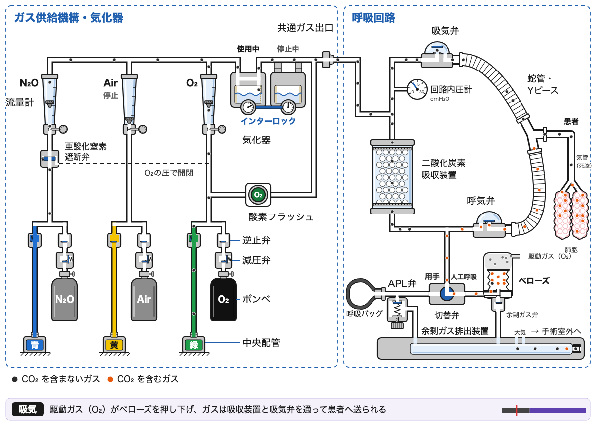
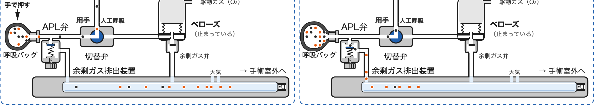
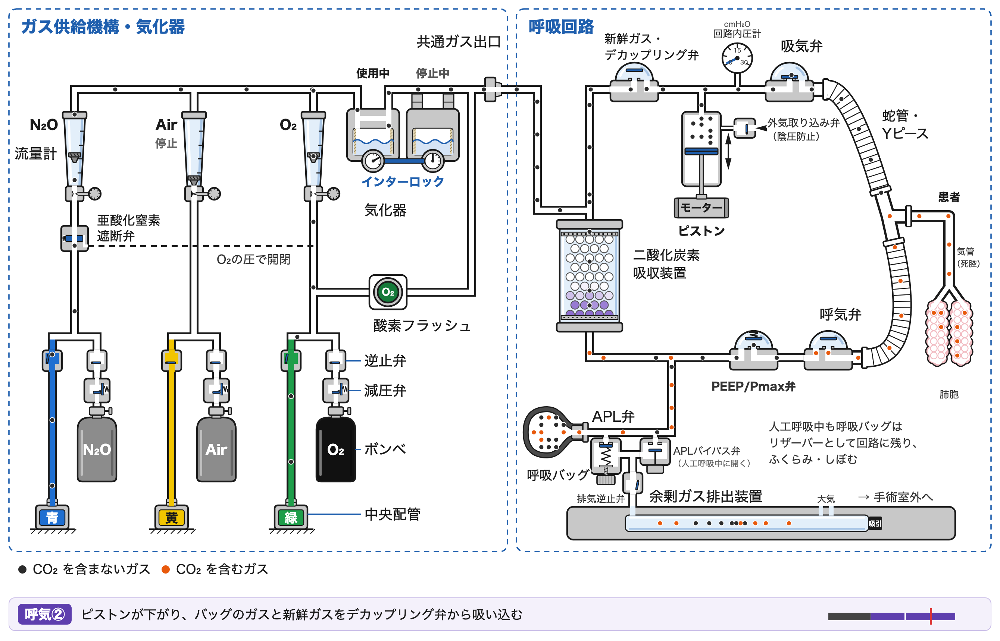
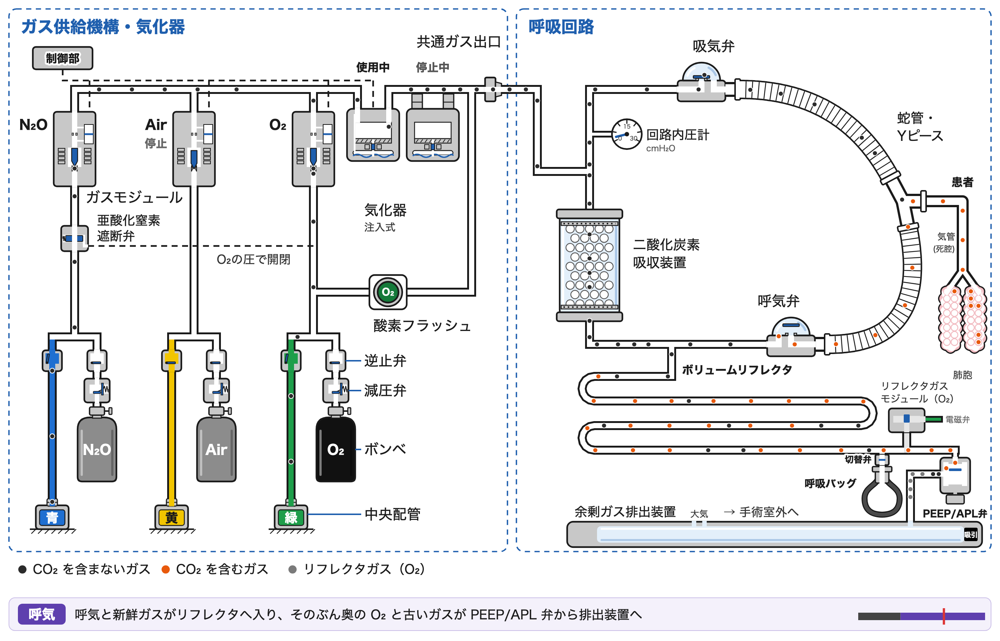
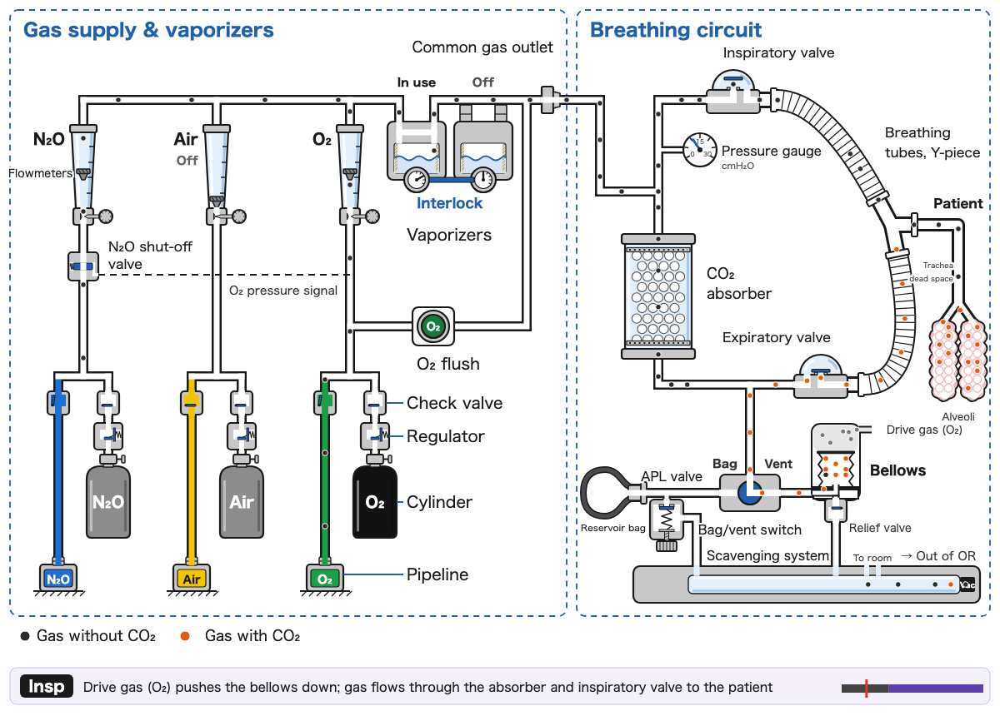

<a id="japanese"></a>

# CircleFlow：麻酔器と呼吸回路のガスの流れ

**日本語** ｜ [English](#english)

麻酔器の中を流れるガスを、1 粒ずつ動く粒で見せる教育用のシミュレーターです。ガス供給機構・気化器から、循環式の呼吸回路（circle system）、人工呼吸器、患者の死腔・肺胞、二酸化炭素吸収装置、余剰ガス排出装置まで、1 呼吸（6 秒）のあいだのガスの動きを 1 つのページで追えます。臨床工学技士・医学生・研修医などの学習用に作りました。

**ページを開く**：https://anesthesia-sims.github.io/circleflow/ ／ English: https://anesthesia-sims.github.io/circleflow/en/



## できること

- **3 つの方式を比べる**：上昇式ベローズ（駆動ガスがベローズを押し下げる）、ピストン式（モーターがピストンを動かす。新鮮ガス・デカップリング弁つき）、ボリュームリフレクタ式（リフレクタガス（O₂）が、長い管にためたガスを膜なしで押し出す。ガス供給は電子制御のガスモジュールと注入式の気化器）を、タブで切り替えて比べられます。
- **CO₂ を含むガスを色で見る**：黒い粒は CO₂ を含まないガス、オレンジの粒は CO₂ を含むガス（呼気）です。肺胞で CO₂ を受け取り、二酸化炭素吸収装置を通ると CO₂ が除かれます。灰の粒はボリュームリフレクタ式のリフレクタガス（O₂）で、患者側のガスと膜なしで接しています。
- **粒を追跡する**：粒をクリックすると、その粒の通った道を赤い足跡で表示します。
- **吸収剤の消費を見る**：CO₂ を吸収した吸収剤は、指示薬の色が白から紫へ変わっていきます（時間を縮めて表示。4 倍・16 倍で早送りできます）。使い切ると CO₂ が吸気側へ戻ります（新鮮ガスが多めの場面では、ほとんど戻りません）。「交換」で新しい吸収剤に戻せます。
- **場面を切り替える**：新鮮ガス（多め／低流量）と換気（人工呼吸／用手換気）を切り替えられます。ボリュームリフレクタ式の人工呼吸では、新鮮ガスが患者の取り込みより少ない「不足」も選べ、リフレクタガス（O₂）が回路へ入っていくのが見えます。方式と合わせて 13 の場面があります。用手換気では、呼吸バッグを手で押して換気し、余ったガスは APL 弁（ボリュームリフレクタ式では PEEP/APL 弁）から排出されます。







## 使い方

`index.html` をブラウザで開くだけで動きます（インターネット接続も、ほかのファイルも要りません）。英語版は `en/index.html` で、見出しの横のリンクで行き来できます。

初めて学ぶ人向けに、画面には図と操作だけを置き、説明は必要なときに重ねて出します。

- **使い方**：「使い方」ボタン（または <kbd>?</kbd> キー）で、画面の上を指が動いて操作を順に見せます。初めて開いたときは自動で出ます
- **見どころ**：ふだんは気づかないが知ると回路の理解が深まる細部を 8 つ、方式を切り替えて見比べながら案内します（余剰ガス弁がつくる PEEP、死腔、呼気中の新鮮ガスの行き先、吸気中の新鮮ガスと 1 回換気量、吸収剤、APL 弁が開く順序、気化器の違い、不足で O₂ が患者に届く）。
- **部品の名前をクリック**：点線の下線がある名前をクリックすると、その部品を拡大して、はたらきを短く説明します。「前へ・次へ」でガスの流れの順に部品をたどれます
- **時刻のバー**：吸気・呼気のバーを押すとその時刻で止まり、いま起きていることを説明します
- **くわしく**：3 つの方式の比較や、吸収剤の消費のくわしい説明
- スペースキー：再生／一時停止
- ← →：0.1 秒ずつ送る
- Esc：説明を閉じる／粒の追跡をやめる
- `index.html?term=inspValve` のように開くと、その部品の説明を開いた状態になります（教科書やスライドから部品へ直接つなぐ用。名前は `src/page_terms.py` の `TERMS`）
- `index.html?type=pistonMan&t=1.5` のように開くと、その場面・時刻で止めた 1 コマになります（動画や図のコマ撮り用）。場面の名前は `bellows`・`bellowsLow`・`bellowsMan`・`bellowsLowMan`・`piston`・`pistonLow`・`pistonMan`・`pistonLowMan`・`reflector`・`reflectorLow`・`reflectorShort`・`reflectorMan`・`reflectorLowMan` です。

## 作り直し方

図（SVG）と粒の経路データは Python のスクリプトが作り、粒の動きはブラウザの中で JavaScript が計算します。`src/` を直したら、次の 2 つで作り直して点検します。

```sh
./build.sh    # build/ に 13 の場面の図と経路データを日本語・英語で作り、index.html と en/index.html にまとめる（Python 3、標準ライブラリだけ）
./check.sh    # 13 の場面の粒の動きを点検する（Node.js）
```

版を上げるときは `VERSION` を直して作り直し、git のタグ（`v1.2.10` の形）を打ちます。2 桁目が上がるときは「更新記録」に 1 行足します。

`check.sh` は場面ごとに、粒が管の外にはみ出していないこと、巻き戻しても同じ状態になること、1 回換気量（1 呼吸で肺胞へ入る粒の数）、吸収剤を使い切るまでの呼吸の数を表示します。

| ファイル | 役割 |
|---|---|
| `src/figure_bellows.py`・`src/figure_piston.py`・`src/figure_reflector.py` | 上昇式ベローズ／ピストン式／ボリュームリフレクタ式の図（SVG）と粒の経路データを作る（`low`：低流量、`short`：不足（リフレクタ式のみ）、`manual`：用手換気、`en`：英語） |
| `src/palette.py`・`src/svg.py`・`src/parts.py`・`src/geometry.py` | 3 つの図で共通の、色、SVG の道具、部品（弁・バッグ・肺胞など）の描き方、折れ線の計算 |
| `src/labels_en.py` | 図の中の文字の英語版（日本語との対応表と、文字の大きさ・位置の調整） |
| `src/sim_common.js`・`src/sim_bellows.js`・`src/sim_piston.js`・`src/sim_reflector.js` | 粒の動きのシミュレーション（ブラウザで動く）。共通部分と方式ごとの部分 |
| `src/build_page.py` | 13 の場面を 1 つのページにまとめる（`--lang en` で英語版） |
| `src/page_css.py`・`src/page_html.py`・`src/page_js.py`・`src/page_terms.py` | ページの見た目、HTML、操作の JavaScript、部品の解説と画面の文（日本語） |
| `src/page_en.py` | ページの英語版の文（画面・部品の解説・場面の説明・使い方） |
| `tests/check.js` | 1 つの場面の粒の動きの点検（`check.sh` が 13 の場面に対して回す） |
| `tools/text_list.py` | ページに出る解説文をすべて Markdown に書き出す |

## 模式図としての注意

- 教育用の模式図です。臨床の判断や、実際の麻酔器の操作・点検に用いるものではありません。内容について保証はありません。
- 部品の形・位置・弁の構成は機種によって異なります。ピストン式は Dräger Fabius 型、ボリュームリフレクタ式は Getinge（Maquet）Flow-i 型の構成を参考にしていますが、特定のメーカーや機種とは関係ありません。
- ガスの量（粒の数）や時間、吸収剤の容量は、見やすさのために縮めたり整えたりした値です。実際の機種どうしの性能の比較ではありません。
- 配管とボンベの識別色は日本の規格に従っています（配管：O₂ 緑・空気 黄・N₂O 青、ボンベ：O₂ 黒・そのほか灰）。

## 更新記録

| 版 | 日付 | 内容 |
|---|---|---|
| 1.4 | 2026-11-05 | 「見どころ」のツアーを追加。ふだんは気づかない細部を 9 つ、方式と場面を自動で切り替えて案内する。1.4.1：開いたときに新しい版があれば 1 回だけ自動で読み直す。1.4.2：見どころを方式ごとに切り替えて見比べる 18 段に（気化器の違いを追加）。1.4.3：ツアーをキーで操作（→ Enter スペースで進む、← BS で戻る、Esc で閉じる） |
| 1.3 | 2026-11-04 | ボリュームリフレクタ式のガス供給を実機（Flow-i）の構成に合わせ、流量計と可変バイパス式の気化器の代わりに、電子制御のガスモジュール・注入式の気化器・制御部を描いた。人工呼吸の新鮮ガスは主に吸気中に流れる形に（1 呼吸の 2/3 を吸気中）。新鮮ガスが患者の取り込みより少なく、リフレクタガス（O₂）が回路へ入っていく「不足」の場面を追加（全 13 場面）。説明文の断定（上昇式ベローズの陰圧、APL 弁が開く条件、リフレクタの両端のガス）を直し、気化器では O₂・N₂O の両方が気化室とバイパスを通るようにした。1.3.1：配管からガスモジュールへの管の途切れと、供給路の粒の間隔の乱れを直し、全場面の 1 回換気量を 13 粒にそろえた。1.3.2：リフレクタ式の人工呼吸で、ガスモジュールより上流の粒を一定に流し、吸気中に多く通す流量の変化はモジュールの弁で作る形にした。1.3.4〜1.3.11：リフレクタガスがガスモジュールから流れ込むようにし、モジュールの内部を弁座のある L 字に、電磁コイルを鉄心の両側の巻線の断面（通電中は黒）に描き直した。押すためのガス（リフレクタガスと上昇式ベローズの駆動ガス）を灰の四角で示し、リフレクタガスのいる範囲の管腔を薄い灰で塗る（ポインターを重ねると名前が出る）。描かれていなかった部品の縁を直した。「不足」の場面は数呼吸で O₂ が肺胞に届く状態から始め、肺胞の中でも O₂ の粒を四角のまま見せる |
| 1.2 | 2026-11-03〜04 | ボリュームリフレクタ式に用手換気の場面を追加（全 12 場面）。3 つの方式の図の幅と配置をそろえ、スマートフォンでは操作部を切り替えボタンにまとめた。余剰ガスの経路、呼吸バッグから出る粒の速さ、笑気の供給の表示などを修正。ボリュームリフレクタ式の新鮮ガスは、一定に流れ、呼気中は吸収装置を逆向きに通ってリフレクタへ入る形に改めた |
| 1.1 | 2026-11-03 | ボリュームリフレクタ式（Getinge Flow-i 型）を追加（人工呼吸の 2 場面）。解説の文を読者向けに整理 |
| 1.0 | 2026-11-02 | 公開。上昇式ベローズとピストン式の 8 場面、日本語版と英語版、部品の解説と使い方のツアー |

表は 2 桁目の版ごとにまとめています。細かな修正（3 桁目）は git のタグと履歴に残します。いまの版は `VERSION` の値で、ページの下にも出ます。

## ライセンス

- **プログラム**（`src/`・`tests/`・`build.sh`・`check.sh`、`index.html` の中の HTML・CSS・JavaScript）：[MIT ライセンス](LICENSE)
- **図と文章**（スクリプトが描く図そのもの、`docs/` の画像、ページと README の説明文）：[クリエイティブ・コモンズ 表示 4.0 国際（CC BY 4.0）](LICENSE-CONTENT)

図や文章を使うときは、次のように出典を示してください。

> 朝元雅明（Masaaki Asamoto）「CircleFlow：麻酔器と呼吸回路のガスの流れ」CC BY 4.0

## 著作者

朝元雅明（Masaaki Asamoto）、麻酔科医

## 謝辞

帝京大学医学部附属溝口病院 麻酔科の平林剛先生から、呼吸回路と人工呼吸器の方式について助言をいただきました。内容の誤りは著者の責任です。

もし間違いに気づかれましたら、[GitHub の Issue](https://github.com/anesthesia-sims/circleflow/issues/new) へ投稿していただくか、メール（[masaaki.asamoto@gmail.com](mailto:masaaki.asamoto@gmail.com?subject=CircleFlow)）でご連絡をお願いします。

---

<a id="english"></a>

# CircleFlow: Gas Flow in the Anesthesia Machine and Breathing Circuit

[日本語](#japanese) ｜ **English**

An educational simulator that shows the gas inside an anesthesia machine as individual moving particles. From the gas supply and vaporizers, through the circle breathing system, the ventilator, the patient's dead space and alveoli, the CO₂ absorber and the scavenging system, you can follow how gas moves during one breath (6 s) on a single page. It was made for clinical engineers, medical students and residents.

**Open the simulator**: https://anesthesia-sims.github.io/circleflow/en/ (English) ／ https://anesthesia-sims.github.io/circleflow/ (Japanese)



## What you can do

- **Compare three ventilator types**: the ascending bellows (drive gas pushes the bellows down), the piston type (a motor drives the piston; with a fresh gas decoupling valve), and the volume reflector type (reflector gas, O₂, pushes the gas stored in a long tube with no membrane between them). Switch between them with the tabs.
- **See CO₂ by color**: black particles are gas without CO₂, orange particles are gas with CO₂ (exhaled gas). Particles pick up CO₂ in the alveoli and lose it in the CO₂ absorber. Gray particles are the reflector gas (O₂) of the volume reflector type, in direct contact with the patient-side gas.
- **Follow a particle**: click a particle to show its path as a red trail.
- **Watch the absorbent being used up**: as the absorbent takes up CO₂, its indicator changes from white to purple (time is compressed; speed up to 4× or 16×). Once it is exhausted, CO₂ returns to the inspiratory side (hardly at all in the scenes with high fresh gas flow). Press Replace for fresh absorbent.
- **Switch scenes**: fresh gas (High / Low flow) and ventilation (Ventilator / Manual). With the volume reflector on the ventilator you can also choose Too low, where fresh gas is less than the patient's uptake and reflector gas (O₂) is seen entering the circuit. Together with the three types, there are 13 scenes. In manual ventilation you squeeze the reservoir bag, and excess gas leaves through the APL valve (the PEEP/APL valve on the volume reflector type).

## How to use

Just open `en/index.html` (English) or `index.html` (Japanese) in a browser; no internet connection or other files are needed. A link next to the title switches languages. When the Japanese page is opened in a browser whose language is not Japanese, it shows a one-line notice pointing to the English version (it does not redirect).

For beginners, the screen shows only the figure and the controls; explanations appear on top only when you ask for them.

- **How to use**: the How to use button (or the <kbd>?</kbd> key) starts a tour in which a finger moves over the screen and shows each control. It starts automatically the first time.
- **Highlights**: a guided tour of eight easy-to-miss details, comparing the three types step by step (the PEEP made by the relief valve, dead space, where fresh gas goes during expiration, fresh gas and tidal volume, the absorbent, when the APL valve opens, how the vaporizers differ, O₂ reaching the patient when fresh gas is too low).
- **Click a part name**: names with a dotted underline zoom in on that part and explain what it does. Prev / Next follow the parts in the order the gas flows.
- **Time bar**: press the inspiration / expiration bar to stop at that moment and see what is happening.
- **Learn more**: how the three types differ, and details of absorbent use.
- Space: play / pause; ← →: step 0.1 s; Esc: close an explanation or stop following a particle.
- Open `en/index.html?term=inspValve` to start with that part's explanation open (for linking from textbooks or slides; the names are the keys of `TERMS` in `src/page_terms.py`).
- Open `en/index.html?type=pistonMan&t=1.5` to get a still frame of that scene at that time (for video or figure capture). Scene names: `bellows`, `bellowsLow`, `bellowsMan`, `bellowsLowMan`, `piston`, `pistonLow`, `pistonMan`, `pistonLowMan`, `reflector`, `reflectorLow`, `reflectorMan`, `reflectorLowMan`.

## Building

Python scripts draw the figures (SVG) and the particle paths; JavaScript computes the particle motion in the browser. After editing `src/`, rebuild and check with:

```sh
./build.sh    # builds the 13 scenes in Japanese and English and writes index.html and en/index.html (Python 3, standard library only)
./check.sh    # checks the particle motion in all 13 scenes (Node.js)
```

To release a new version, update `VERSION`, rebuild, and tag the commit (`v1.2.10`). Add a line to the Changelog when the minor version changes.

For each scene, `check.sh` reports that no particle leaves its tube, that rewinding reproduces the same state, the tidal volume (particles entering the alveoli per breath), and the breath at which the absorbent is used up.

| File | Purpose |
|---|---|
| `src/figure_bellows.py`, `src/figure_piston.py`, `src/figure_reflector.py` | Draw the figure (SVG) and particle paths for each ventilator type (`low`: low flow, `short`: too low (reflector only), `manual`: manual ventilation, `en`: English labels) |
| `src/palette.py`, `src/svg.py`, `src/parts.py`, `src/geometry.py` | Shared by the three figures: colors, SVG helpers, part drawings (valves, bag, alveoli, …), polyline math |
| `src/labels_en.py` | English labels for the figures (mapping from Japanese, with per-label size and position) |
| `src/sim_common.js`, `src/sim_bellows.js`, `src/sim_piston.js`, `src/sim_reflector.js` | Particle simulation (runs in the browser): shared part and the three ventilator types |
| `src/build_page.py` | Combines the 13 scenes into one page (`--lang en` for English) |
| `src/page_css.py`, `src/page_html.py`, `src/page_js.py`, `src/page_terms.py` | Page styles, HTML, interaction script, and the Japanese explanations and UI text |
| `src/page_en.py` | English page text (controls, part explanations, scene narration, tour) |
| `tests/check.js` | Particle check for one scene (`check.sh` runs it for all 13) |
| `tools/text_list.py` | Writes all explanation text shown on a page to Markdown |

## Notes on the schematic

- This is an educational schematic. It is not for clinical decisions or for operating or checking real anesthesia machines, and comes with no warranty.
- The shape and position of parts and the valve arrangement vary between machines. The piston type is modeled on the Dräger Fabius layout and the volume reflector type on the Getinge (Maquet) Flow-i, but neither is affiliated with any manufacturer or model.
- Gas volumes (number of particles), timing and absorbent capacity are scaled or adjusted for clarity; they do not compare the performance of real machines.
- Gas color codes follow Japanese standards (pipelines: O₂ green, air yellow, N₂O blue; cylinders: O₂ black, others gray).

## Changelog

| Version | Date | Changes |
|---|---|---|
| 1.4 | 2026-11-05 | Highlights tour: nine easy-to-miss details of the circuit, with the type and scene switched automatically for each. 1.4.1: the page reloads itself once when a newer version has been published. 1.4.2: the highlights tour now compares the types step by step (18 steps, including the vaporizers). 1.4.3: keyboard control of the tours (→ Enter Space next, ← Backspace back, Esc close) |
| 1.3 | 2026-11-04 | The gas supply of the volume reflector figure now follows the real machine (Flow-i): electronically controlled gas modules, injection vaporizers and a control unit replace the flowmeters and variable-bypass vaporizers. During mechanical ventilation the fresh gas is delivered mainly during inspiration (two thirds of each breath). New Too low scene, in which fresh gas is less than the patient's uptake and reflector gas (O₂) enters the circuit (13 scenes in all). Overstated explanations (negative pressure with the ascending bellows, when the APL valve opens, the gas at the two ends of the reflector) were corrected, and both O₂ and N₂O now pass through the vaporizing chamber and the bypass. 1.3.1: fixed the gap between the pipeline and the gas modules and the uneven spacing of supply particles, and brought the tidal volume of every scene to 13 particles. 1.3.2: on the reflector ventilator scenes the supply particles upstream of the gas modules now flow uniformly, and the inspiratory-weighted flow is made at the module valve. 1.3.4 to 1.3.11: reflector gas now flows in from the gas module, whose interior is redrawn as an L-shaped path with a valve seat and a solenoid coil shown in section on both sides of the plunger (dark while energized); gas that pushes (reflector gas and the bellows drive gas) is shown as gray squares, and the part of the reflector filled with reflector gas is shaded light gray (its name appears on hover); missing part outlines were restored. The Too low scene now starts a few breaths before O₂ reaches the alveoli, where it stays shown as a square |
| 1.2 | 2026-11-03 to 04 | Manual ventilation scenes for the volume reflector type (12 scenes in all). The three figures now share the same width and layout, and on phones the controls fold into cycling buttons. Fixes to the scavenging path, the speed of particles leaving the reservoir bag, the display of the N₂O supply, and more. On the volume reflector type, fresh gas now flows constantly and, during expiration, passes backward through the absorber into the reflector |
| 1.1 | 2026-11-03 | Volume reflector type (modeled on the Getinge Flow-i) with two ventilator scenes. Explanations rewritten for readers |
| 1.0 | 2026-11-02 | First release: ascending bellows and piston types, 8 scenes, Japanese and English pages, part explanations and a guided tour |

The table lists minor versions; patch releases are recorded as git tags. The current version is the value in `VERSION`, shown at the bottom of the page.

## License

- **Code** (`src/`, `tests/`, `build.sh`, `check.sh`, and the HTML, CSS and JavaScript in the pages): [MIT License](LICENSE)
- **Figures and text** (the figures drawn by the scripts, the images in `docs/`, and the explanatory text of the pages and this README): [Creative Commons Attribution 4.0 International (CC BY 4.0)](LICENSE-CONTENT)

When you use the figures or text, please credit them as:

> Masaaki Asamoto, "CircleFlow: Gas Flow in the Anesthesia Machine and Breathing Circuit", CC BY 4.0

## Author

Masaaki Asamoto (朝元雅明), anesthesiologist

## Acknowledgments

We thank Dr. Go Hirabayashi (Department of Anesthesiology, Teikyo University School of Medicine Hospital Mizonokuchi) for advice on the breathing circuit and ventilator types. Any errors are the author's own.

If you notice a mistake, please report it on [GitHub Issues](https://github.com/anesthesia-sims/circleflow/issues/new) or by email ([masaaki.asamoto@gmail.com](mailto:masaaki.asamoto@gmail.com?subject=CircleFlow)).
